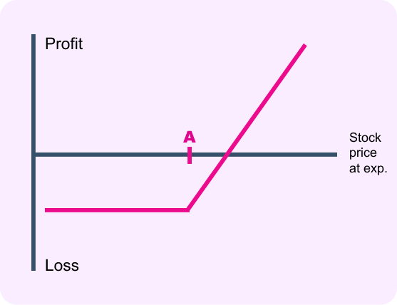
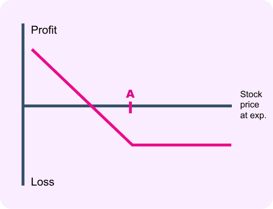
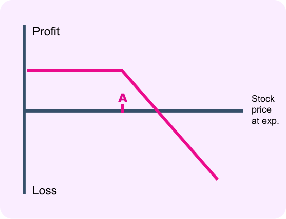
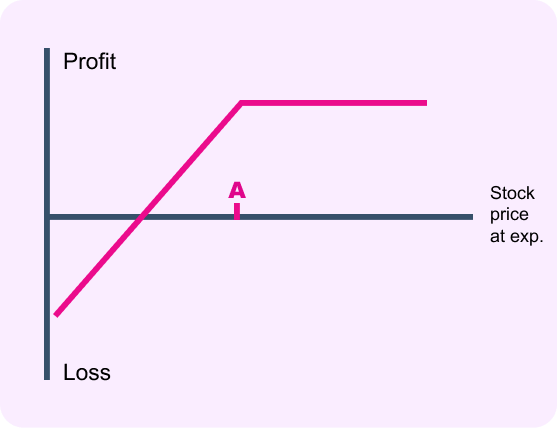
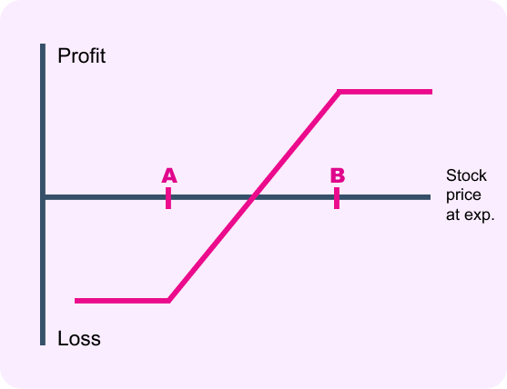
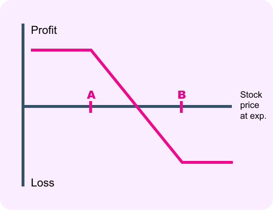
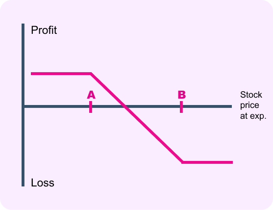
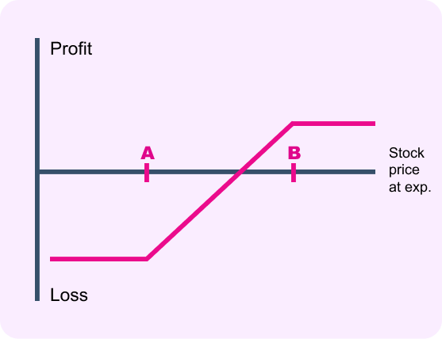
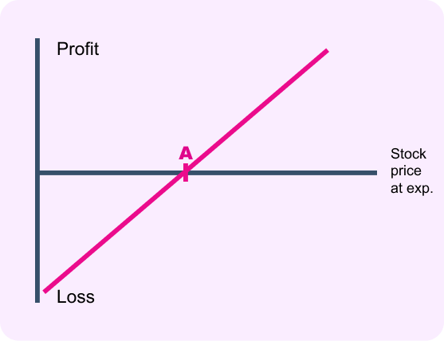
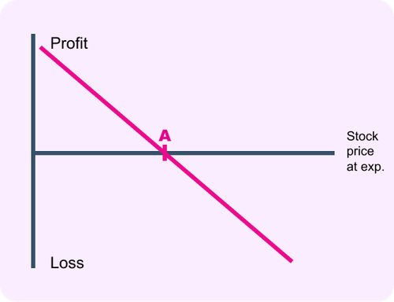

# 期权介绍

## Basics

期权价值 = 内在价值 + 时间价值

## Black-Scholes Model 期权定价模型

如果：
- 期权只能在到期日执行（欧式期权），股票或期权交易没有费用或税收
- 股票或期权有效期内没有红利支付，也没有其他分配（没有股息）
- 无风险利率为常数且保持不变
- 投资者可以以无风险利率无限量地借入或贷出资金
- 不存在无风险套利机会
- 股票可以被自由地买卖，可以做空，而且股票或期权无限可分（充分定价 双向交易）
- 股票交易是连续的，而且价格遵守随机游走的几何布朗运动

那么：

$$
\frac {\partial f} {\partial t} + r S \frac {\partial f} {\partial S} + \frac{1}{2} \sigma^2 S^2 \frac {\partial^2 f}{\partial S^2}  = r f
$$

也就是

$$
\Theta + r S \Delta + \frac{1}{2} \sigma^2 S^2 \Gamma = r f 
$$

局限性：
- 假设股票价格波动满足几何布朗运动，那么股价分布符合对数正态分布，也就是说股票价格是光滑的，没有考虑到重大事件引起的股价跳跃
- 实际上投资者无法按照同一无风险利率无限借入或贷出资金
- 股票不是无限可分，而且有最小交易单位约束
- 股票或期权交易有不可忽略的交易成本
- 股票波动率不可能保持不变（比如随着股票价格上涨，波动率一般会下降）

## Put-Call Parity 期权平价公式

$$
C - P = S - K e ^ {- r t}
$$

也就是说：买入看涨期权 + 卖出看跌期权 = 现价买入标的物 + 行权价卖出标的物

对应：+ Call - Put = + Stock - Strike

## Greeks 希腊字母

$$
P\&L = Delta \Delta S + \frac{1}{2} Gamma (\Delta S)^2 + Theta \Delta t + Vega \Delta \sigma + Rho \Delta r + \dots
$$

当期货价格变动 $\Delta S$，时间流逝 $\Delta t$，隐含波动率变动 $\Delta \sigma$，无风险利率变动 $\Delta r$ 时， 持仓收益变动 $P\&L$。

期货：$S_0 + \Delta S$

期权：$f_0 + Delta \Delta S + \frac{1}{2} Gamma (\Delta S)^2 + Theta \Delta t + Vega \Delta \sigma$

Delta: 越ITM越大 越OTM越小

Gamma: 越ATM越大 越往两边越小

Theta: 越邻近到期越大

Vega: 

## 期权策略

### Long Call 买入看涨期权

看大涨，买看涨

买入一个以行权价格买入股票的权利，支付权利金

构造：
- 买入一份行权价为A的看涨期权

| Delta | Gamma | Theta | Vega |
| :-: | :-: | :-: | :-: |
| + | + | - | + |

### Long Put 买入看跌期权

看大跌，买看跌

买入一个以行权价格卖出股票的权利，支付权利金

构造：
- 买入一份行权价为A的看跌期权

| Delta | Gamma | Theta | Vega |
| :-: | :-: | :-: | :-: |
| - | + | - | + |

### Short Call 卖出看涨期权

看小涨，卖看跌

承担以行权价格卖出股票的义务，得到权利金

构造：
- 卖出一份行权价为A的看涨期权

| Delta | Gamma | Theta | Vega |
| :-: | :-: | :-: | :-: |
| - | - | + | - |

### Short Put 卖出看跌期权

看小跌，买看涨

承担以行权价格买入股票的义务，得到权利金

构造：
- 卖出一份行权价为A的看跌期权

| Delta | Gamma | Theta | Vega |
| :-: | :-: | :-: | :-: |
| + | - | + | - |

### Long Call Spread 牛市看涨价差策略

买低卖高就是做多价差

构造：
- 买入一份行权价为A的看涨期权
- 卖出一份行权价为B的看涨期权

| Delta | Gamma | Theta | Vega |
| :-: | :-: | :-: | :-: |
| + | + ➤ - | - ➤ + | + ➤ - |

### Long Put Spread 牛市看跌价差策略

买低卖高就是做多价差

构造：
- 买入一份行权价为A的看跌期权
- 卖出一份行权价为B的看跌期权

| Delta | Gamma | Theta | Vega |
| :-: | :-: | :-: | :-: |
| + | + ➤ - | - ➤ + | + ➤ - |

### Short Call Spread 熊市看涨价差策略

买高卖低就是做空价差

构造：
- 卖出一份行权价为A的看涨期权
- 买入一份行权价为B的看涨期权

| Delta | Gamma | Theta | Vega |
| :-: | :-: | :-: | :-: |
| - | - ➤ + | + ➤ - | - ➤ + |

### Short Put Spread 熊市看跌价差策略

买高卖低就是做空价差

构造：
- 买入一份行权价为A的看跌期权
- 卖出一份行权价为B的看跌期权

| Delta | Gamma | Theta | Vega |
| :-: | :-: | :-: | :-: |
| - | - ➤ + | + ➤ - | - ➤ + |

### Synthetic Long Future 合成买入标的资产

买入看涨期权 + 卖出看跌期权 = 买入标的资产

构造：
- 买入一份看涨期权
- 卖出一份看跌期权

| Delta | Gamma | Theta | Vega |
| :-: | :-: | :-: | :-: |
| 1 | 0 | 0 | 0 |

### Synthetic Short Future 合成卖出标的资产

卖出看涨期权 + 买入看跌期权 = 卖出标的资产

构造：
- 卖出一份看涨期权
- 买入一份看跌期权

| Delta | Gamma | Theta | Vega |
| :-: | :-: | :-: | :-: |
| -1 | 0 | 0 | 0 |

### Synthetic Long Call 合成买入看涨期权

买入看跌期权 + 买入标的资产 = 买入看涨期权

常用的是: 买入虚值看涨期权 + 买入标的资产 = 买入实值看涨期权

构造：
- 买入一份标的资产
- 买入一份行权价为A的看跌期权

| Delta | Gamma | Theta | Vega |
| :-: | :-: | :-: | :-: |
| + | + | - | + |

### Synthetic Long Put 合成买入看跌期权

买入看涨期权 + 卖出标的资产 = 买入看跌期权

常用的是: 买入虚值看涨期权 + 卖出标的资产 = 买入实值看跌期权

构造：
- 卖出一份标的资产
- 买入一份行权价为A的看涨期权

| Delta | Gamma | Theta | Vega |
| :-: | :-: | :-: | :-: |
| - | + | - | + |

### Synthetic Long Call 合成卖出看涨期权

卖出看跌期权 + 卖出标的资产 = 卖出看涨期权

常用的是: 卖出虚值看涨期权 + 卖出标的资产 = 卖出实值看涨期权

构造：
- 卖出一份标的资产
- 卖出一份行权价为A的看跌期权

| Delta | Gamma | Theta | Vega |
| :-: | :-: | :-: | :-: |
| - | - | + | - |

### Synthetic Short Put 合成卖出看跌期权

卖出看涨期权 + 买入标的资产 = 卖出看跌期权

常用的是: 卖出虚值看涨期权 + 买入标的资产 = 卖出实值看跌期权

构造：
- 买入一份标的资产
- 卖出一份行权价为A的看涨期权

| Delta | Gamma | Theta | Vega |
| :-: | :-: | :-: | :-: |
| + | - | + | - |
